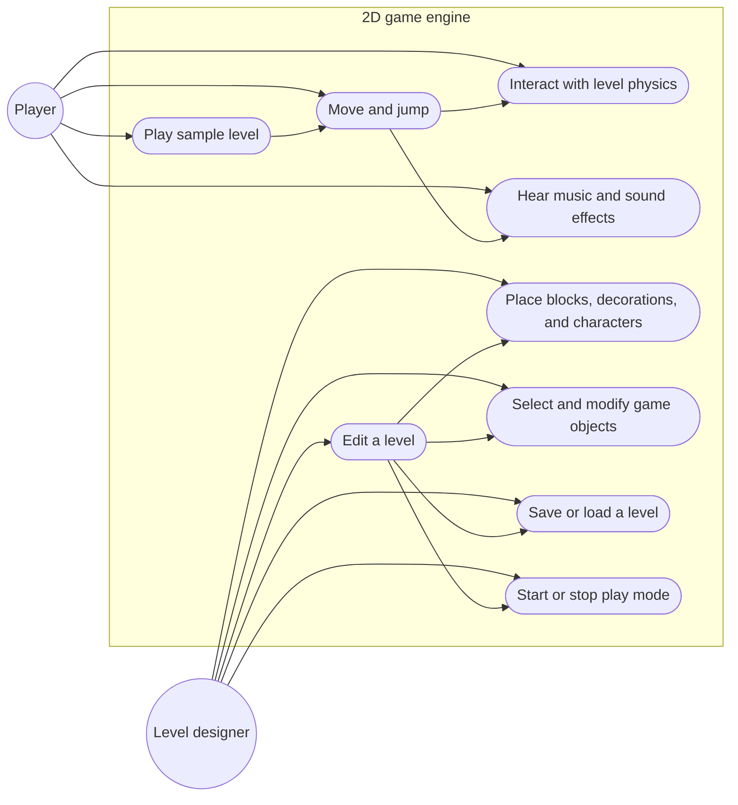
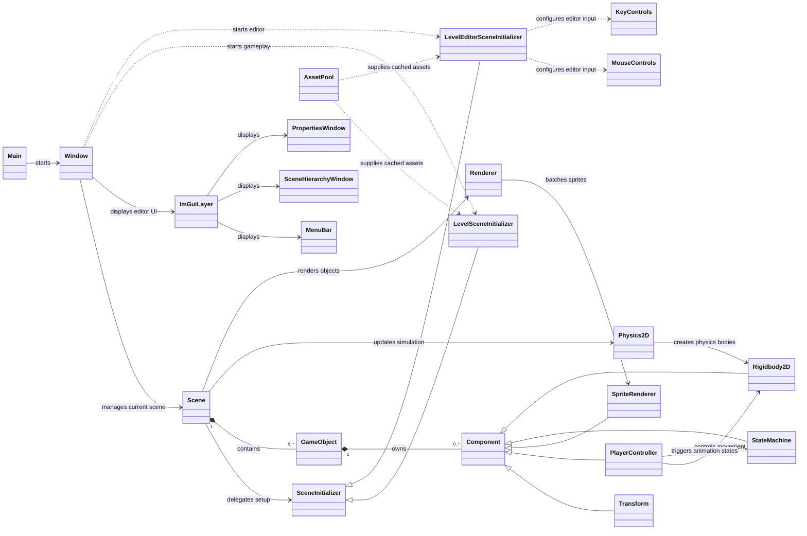

# Custom 2D Game Engine Development

> **Project draft**  
> **Repository:** `codingminecraft/MarioYoutube`  
> **Status:** Draft  
> **Planned duration:** 9 weeks  
> **Mentor:** Mrs Vagisha Mishra  
> **Original target environment:** Java 1.8+, Gradle 6.3+, LWJGL 3, Box2D, and ImGui

## Team

| Name | Roll number |
|---|---|
| Aditya Maurya | 20251501010 |
| Adarsh Ranjan | 20251501006 |
| Abhyam Apurv | 20251501005 |
| Abhinav Shukla | 20251501004 |
| Aditya Thori | 20251501009 |

## Problem Statement

Learning how a game engine works internally can be difficult. Many learning resources rely on high-level commercial engines such as Unity and Unreal Engine, which hide underlying systems, while other tutorials cover only isolated concepts instead of a complete engine.

Developers also face challenges when designing modular engine architecture, integrating real-time debugging and level-editing tools, and combining libraries such as LWJGL, OpenGL, and Box2D into one framework. This project addresses those challenges by developing a custom engine that separates rendering, simulation, asset management, and gameplay, while integrating developer tooling and graphics and physics libraries.

## Project Overview

The project is a Java 2D game engine with a Mario-style sample level and an integrated level editor. The current source includes scene and game-object management, component-based behavior, sprite rendering and animation, 2D physics, asset and sound handling, and editor controls for building and saving levels.

The diagrams below describe the current project implementation. They are Mermaid diagrams embedded in Markdown, so GitHub renders them inline. The outdated images from the original Word draft have intentionally not been copied.

## Use Case Diagram

### Use Case Notes

- **Player:** Plays the sample level, moves left and right, jumps, collides with ground objects, and hears gameplay audio.
- **Level designer:** Uses the editor to place objects, select and modify them, save or load level data, and switch between editing and play mode.
- Player movement and jumping are implemented in `PlayerController`. Editor object selection and placement are implemented in `MouseControls` and the editor interface.

## Class Diagram

### Class Diagram Notes

- `Scene` owns its game objects and coordinates physics updates and rendering.
- `GameObject` is a component-based entity. `Component` is the base class for transform, player control, rendering, animation-state, and rigid-body behavior.
- `Window` switches between gameplay and editor scenes. The editor UI is provided through ImGui.
- `Physics2D` integrates game objects with Box2D; `Renderer` draws sprite components; `AssetPool` supplies cached runtime assets.

## Nine-Week Java Concept Plan

The original learning plan is organized by the Java concepts identified in the project source. Each week has a topic, source-based study tasks, and a deliverable.

### Phase 1: Object-Oriented Java Foundations (Weeks 1-4)

#### Week 1: Inheritance and Access Specifiers

**Objective:** Understand how classes reuse and extend behavior, and how access levels control visibility.

**Topics and tasks:**

- Study `Component` and its subclasses as examples of inheritance.
- Review scene initializers that extend `SceneInitializer`.
- Identify public and private members in `GameObject` and `Component`; document that a protected-access example was not found.

**Deliverable:** A source-based explanation of inheritance and public/private access control, with the protected-access gap documented.

#### Week 2: Constructors

**Objective:** Understand how objects are initialized when instances are created.

**Topics and tasks:**

- Study default and parameterized constructors in `GameObject`, `Frame`, and `Transform`.
- Identify the values initialized by each constructor.
- Compare constructor usage across core engine classes.

**Deliverable:** A constructor reference sheet explaining representative game-object and component initialization.

#### Week 3: Method Overloading

**Objective:** Understand how methods with the same name can support different parameter lists.

**Topics and tasks:**

- Examine overloaded methods in `editor/JImGui.java`.
- Examine overloaded mathematical helper methods in `util/JMath.java`.
- Compare parameter lists and the purpose of each overload.

**Deliverable:** A documented set of method-overloading examples from the application source.

#### Week 4: Nested Classes and Static Variables

**Objective:** Understand nested class structure and class-level shared data.

**Topics and tasks:**

- Study the private nested `StateTrigger` class inside `StateMachine`.
- Identify static variables used for shared ID counters and editor settings.
- Explain the difference between instance data and class-level data.

**Deliverable:** A source-based explanation of `StateTrigger` and static variables.

### Phase 2: Class-Level Features and Exception Handling (Weeks 5-7)

#### Week 5: Static Methods and `final`

**Objective:** Understand class-level utility methods and fields whose values or references are restricted from reassignment.

**Topics and tasks:**

- Review static initialization helpers in `GameObject` and `Component`.
- Study static mathematical utility methods in `JMath`.
- Identify final fields in `Window`, `Renderer`, and `RenderBatch` and explain their role.

**Deliverable:** A documented collection of static-method and final-field examples.

#### Week 6: Exception Handling

**Objective:** Understand how application code detects, reports, and handles exceptional conditions.

**Topics and tasks:**

- Locate `try`/`catch` usage in `Component`, `Scene`, and `Shader`.
- Explain the purpose of the exception-handling paths found in the source.
- Relate exception handling to resource loading and application operations.

**Deliverable:** A source-based report describing exception-handling examples in the game.

#### Week 7: `try`, `catch`, `throw`, and `throws`

**Objective:** Understand the roles of the four exception-related Java constructs.

**Topics and tasks:**

- Trace examples of `try` and `catch` in the source.
- Identify `throw` and `throws` usage in `Shader`, `Window`, and `ComponentDeserializer`.
- Record whether the exception types found are Java or library types.

**Deliverable:** A construct-by-construct explanation with source references.

### Phase 3: Type Casting and Consolidation (Weeks 8-9)

#### Week 8: Class-to-Basic Type Casting

**Objective:** Understand how wrapper-class values stored as `Object` references are converted back to primitives.

**Topics and tasks:**

- Study class-to-basic casting and unboxing examples in `components/Component.java` for `int`, `float`, and `boolean`.
- Explain how unboxing is used when component properties are read from `Object` values.

**Deliverable:** A source-based explanation of class-to-basic casting and unboxing.

#### Week 9: Class-to-Class Type Casting and Java Topics Review

**Objective:** Understand reference casting between class types and consolidate the Java concepts confirmed in the application source.

**Topics and tasks:**

- Review the nested-class reference cast in `StateMachine`, `Class.cast` in `GameObject`, and the `GameObject` reference cast in `SceneHierarchyWindow`.
- Prepare a consolidated checklist of Java concepts confirmed as implemented in the source.

**Deliverable:** A final Java concepts report with source locations.

## Topics Not Implemented in the Game Source

The following topics were marked as not found in the inspected application source. They should not be presented as implemented game features:

- **Finally block:** No `finally` block was found.
- **User-defined exceptions:** No custom exception class was found.
- **Catching base-class and derived-class exceptions:** No catch sequence demonstrating a derived exception before its base exception was found.
- **Multithreading:** No application-created worker threads were found.
- **Creating and implementing threads:** No custom `Thread` or `Runnable` implementation was found.
- **Extending the `Thread` class:** No class extends `java.lang.Thread`.
- **Implementing the `Runnable` interface:** No class implements `java.lang.Runnable`.
- **Thread life cycle:** No thread state or lifecycle example was found.
- **Thread methods:** No usage of `Thread.start()`, `run()`, `sleep()`, `join()`, or `yield()` was found. Game/component lifecycle methods named `start` are not `Thread.start()`.
- **Thread synchronization:** No synchronized methods or blocks were found.
- **Basic-to-class type casting:** No explicit primitive-to-wrapper conversion was found.
